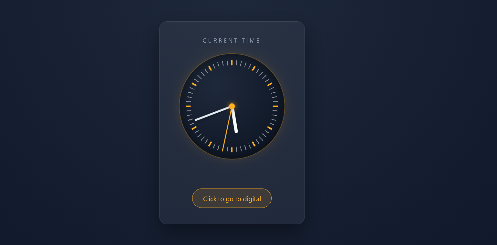
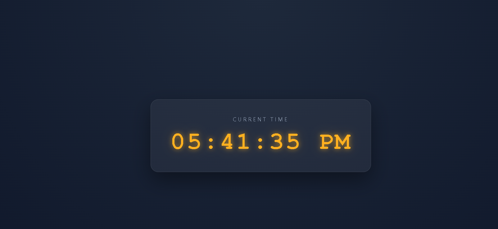

# Chrono Dial

A clock project with two views: an analog clock with moving hands, and a digital clock with a live 12-hour display. You can switch between them with a single button.

## Screenshots

### Analog Clock


### Digital Clock


## Features

- **Analog clock:** hour, minute, and second hands that update every second, with a smooth spring-like motion
- **Digital clock:** live time in 12-hour format with AM/PM
- **Navigation:** a button on each page to switch between the two views
- **Responsive design:** both clocks scale to fit phones and large screens

## How to Run

1. Clone the repository:
   ```bash
   git clone https://github.com/abdallaahemd/Chrono-Dial.git
   ```
2. Open the project folder.
3. Open `index.html` (analog clock) in your browser.
4. Click the button to open the digital clock.

## Project Structure

```
Chrono-Dial/
├── index.html      # Analog clock page
├── Fstyle.css      # Styles for the analog clock
├── Fmain.js        # Hand rotation logic for the analog clock
├── digital.html    # Digital clock page (styles included)
└── screenshots/    # Screenshots used in this README
```

## What I Learned

- Rotating elements with CSS `transform` and `transform-origin`
- Converting time values into degrees for each clock hand
- Updating the DOM every second with `setInterval`
- Building a responsive layout with Flexbox and `clamp()`

## Built With

- HTML
- CSS
- JavaScript

## Author

**Abdallah Ahmed**: Programming instructor and developer
- LinkedIn: https://www.linkedin.com/in/abdalla-konsowa-386414203
- itch.io: https://abdallak.itch.io/
